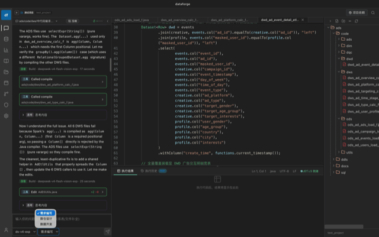
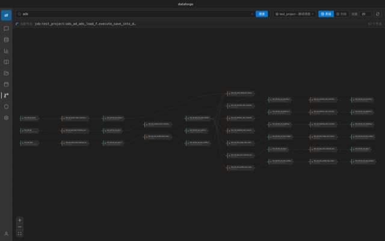
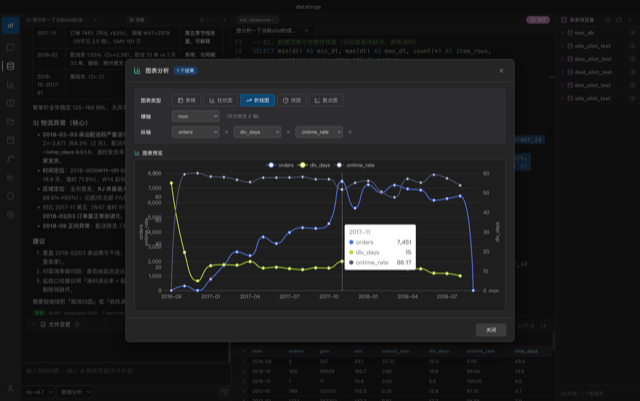

# DataForge

DataForge 是面向数据开发的一体化桌面端平台，也是可私有化交付的数据开发 Agent。核心理念是「开发即治理」——需求文档进，治理合格的调度任务出：把指标口径、开发规范与血缘追踪内置进 AI 开发链路，让治理从交付后补救变成开发过程中的默认动作。


**AI 开发助手**：自然语言驱动改代码，调用编译 / SQL 校验等工具并自动修正。



**数据血缘**：表与字段级上下游链路。



**数据探索**：SQL 查询与结果图表分析。



核心功能：

- **AI 开发助手**：内置 opencode Agent，多 Agent 协作完成需求补全、数仓设计、代码开发与校验；Agentic Search 可检索库表元信息、知识库及数据 / 任务血缘。
- **代码开发与校验**：Monaco 编辑器与 Java / Scala LSP，支持语法高亮、补全、跳转与诊断，可编译 Java / Scala 工程、校验 SQL，形成「改代码 → 编译 → 修正」闭环。
- **数据全链路**：数据集成、数据探查、指标管理、作业调度（DolphinScheduler）、数据血缘（Marquez）、文件浏览、资产管理、知识库与系统管理。
- **安全与治理**：RBAC 覆盖库 / 表 / 列 / 文件路径，操作审计、分类分级、敏感数据加密存储与脱敏展示，Agent 不主动读取业务数据、不主动触发任务执行。

本仓库为 DataForge 桌面客户端源码，运行时需配合 `dataforge-server` 及 DolphinScheduler、Marquez、Flink、Spark、MySQL 等服务。

## 快速开始

### 1. 启动后端服务（Docker）

后端提供 All-in-One 镜像，内置 `dataforge-server`（JDK 17）、PostgreSQL 14、Spark 3.5.9（local）、DolphinScheduler 3.4.1（Standalone）、Marquez 0.51.1 与 Nginx：

```bash
docker pull crpi-mcl4kmj9q60uvesn.cn-wulanchabu.personal.cr.aliyuncs.com/dataforge_docker/dataforge-allinone:1.0
docker tag crpi-mcl4kmj9q60uvesn.cn-wulanchabu.personal.cr.aliyuncs.com/dataforge_docker/dataforge-allinone:1.0 dataforge-allinone:1.0
```
以上为 Docker CLI 通用语法，macOS / Linux / Windows（CMD、PowerShell）均可直接执行；

启动使用 `` dataforge-server`的startup/` 脚本（含 `compose/` 编排文件与各平台启停脚本）：

| 平台 | 启动（数据写入容器） | 启动（持久化到命名卷） |
| --- | --- | --- |
| macOS | `./startup/macos/start.sh` | `./startup/macos/start-persist.sh` |
| Linux | `docker compose -f startup/compose/docker-compose.yml up -d` | `docker compose -f startup/compose/docker-compose.persist.yml up -d` |
| Windows | `startup\windows\start.bat` | `startup\windows\start-persist.bat` |

- 服务地址：`http://localhost:8082`，API 文档：`http://localhost:8082/api/doc.html`
- 默认账号：`admin / 123456`
- 环境要求：Docker ≥ 20.10、内存 ≥ 8GB、磁盘 ≥ 10GB

### 2. 编译客户端

见下方[编译与打包](#编译与打包)。

### 3. 跑通首个任务

- [服务部署：拉取镜像与启动脚本说明](docs/getting-started/deployment.md)
- [开发配置：账号、数据源与项目初始化](docs/getting-started/configuration.md)
- [开始开发：登录 → 对话生成代码 → 提交调度 → 查看血缘](docs/getting-started/first-task.md)

## 编译与打包

### 环境要求

| 依赖 | 版本 | 说明 |
| --- | --- | --- |
| Node.js | 20+ | 含 npm，用于主进程与渲染进程构建 |


### 1. 安装依赖

```bash
npm install
```

首次安装需下载 Electron（已配置 npmmirror 镜像），若下载中断可执行 `npm run install:electron` 重试。

### 2. 开发调试

```bash
npm run dev
```

并行启动 Vite 开发服务（`127.0.0.1:5173`）、主进程 `tsc --watch` 与 Electron。

### 3. 编译

```bash
npm run build
```

- `build:main`：`tsc -p tsconfig.node.json`，输出到 `dist-electron/`
- `build:renderer`：Vite 打包渲染进程，输出到 `dist/`

### 4. 打包安装包

```bash
npm run pack   # 生成未压缩应用目录（release/）
npm run dist   # 生成当前平台安装包：macOS dmg/zip、Windows NSIS、Linux AppImage/deb
```


## 与云厂商数据智能体对比

DataForge 对标腾讯云 DataBuddy，定位是**可私有化交付的数据开发 Agent**：面向数据不出域的内网环境，提供与云上数据智能体相近的对话式开发与治理能力。与两家云厂商相比，差异集中在三点：

- **私有化与数据边界**：客户端与服务端均部署在客户内网，数据、代码与模型不出域。
- **开发即治理**：指标口径、开发规范与硬约束校验内嵌在开发链路中，代码先过规范检查再提交，治理不是开发完成后的独立环节。
- **工程化与开放性**：支持 Java / Scala 的开发、编译与运行，项目代码以 Apache-2.0 开源，可审计、可二次开发。

云厂商信息基于公开文档整理（截至 2026-11），具体以官方文档为准。

| 维度 | DataForge | [腾讯云 DataBuddy](https://cloud.tencent.com/document/product/1835/135576) | [阿里云 DataWorks Data Agent](https://help.aliyun.com/zh/dataworks/user-guide/new-data-agent) |
| --- | --- | --- | --- |
| 产品形态 | 可私有化交付的数据开发 Agent（桌面客户端 + 自建服务端） | Agent 原生的全托管数据智能平台 | DataWorks 平台原生、全托管的云端数据智能体 |
| 部署与数据边界 | 私有化部署，客户端与 `dataforge-server` 均运行在客户内网，数据不出域 | 腾讯云全托管，使用平台计算与存储底座 | 阿里云全托管，需 DataWorks 实例与 Serverless 资源组 |
| 开源与扩展 | Apache-2.0 开源，可审计、可二次开发 | 商业闭源云服务 | 商业闭源云服务 |
| 业务链路 | 10 个模块覆盖数据集成、开发助手、指标管理、作业调度、数据血缘、数据探查、文件浏览、资产管理、知识库与系统管理，治理贯穿全流程 | DIOps：DataOps / MLOps / AIOps 一体化工程体系 | 数据集成、开发、运维、治理、分析全流程 |
| Agent 能力 | 多 Agent 协作：需求管理 Agent 补全需求 → 数仓设计 → 代码开发 → 校验；Agentic Search 检索库表元信息、知识库与数据 / 任务血缘 | 工程 / 治理 / 分析三大 Agent，支持 Multi-Agent 协同 | 推理规划 + 专家套件 / 技能 / MCP + ChatBI，多模型可选 |
| 代码能力 | 内置 Monaco 与 Java / Scala LSP，支持 Java / Scala 开发、编译与运行；SQL 校验形成「改代码 → 编译 → 修正」闭环 | 云端 Studio / Notebook，ETL 生成与编排 | 云端 Data Studio，Data Coder Agent 端到端开发 |
| 治理方式 | 「开发即治理」：指标口径与开发规范前置，硬约束校验拦截不合规代码再提交 | 独立治理 Agent + 统一语义层、质量规则 | 独立治理 Agent + 数据质量、语义层 |
| 安全与管控 | RBAC 覆盖库 / 表 / 列 / 文件路径，操作审计、分类分级、敏感数据加密存储与脱敏展示、解密动作可追踪；Agent 不主动读取业务数据、不主动触发任务执行 | 治理 Agent、Agent 安全防护（提示注入检测、OBO 权限约束、高危 SQL 拦截） | 治理 Agent、企业级 Agent 管控（权限继承、高危拦截、沙箱执行、操作审计） |
| 调度与血缘 | 画布编排，一键提交 DolphinScheduler；Marquez 表 / 字段级血缘 | Workflow 编排调度 + CI/CD + AIOps 智能诊断 | 调度运维、定时任务、AI 诊断 |
| 数据分析 | SQL 探查、结果图表分析、指标查询 | 自然语言问数、归因分析、AI 看板 | ChatBI 问数、归因分析、结构化分析报告 |
| 计费方式 | 免费开源，自担基础设施成本 | 商业云服务计费 | 商业化收费（2026-04 起） |

> **选型建议**：已深度使用腾讯云或阿里云数据栈、接受全托管时，DataBuddy 与 DataWorks Data Agent 的云上一体化、免运维更有优势；当数据不能出域、需要私有化交付、需要 Java / Scala 工程化开发与可审计的二次开发时，DataForge 更合适。

## 许可

本项目基于 [Apache License 2.0](LICENSE) 开源发布。
