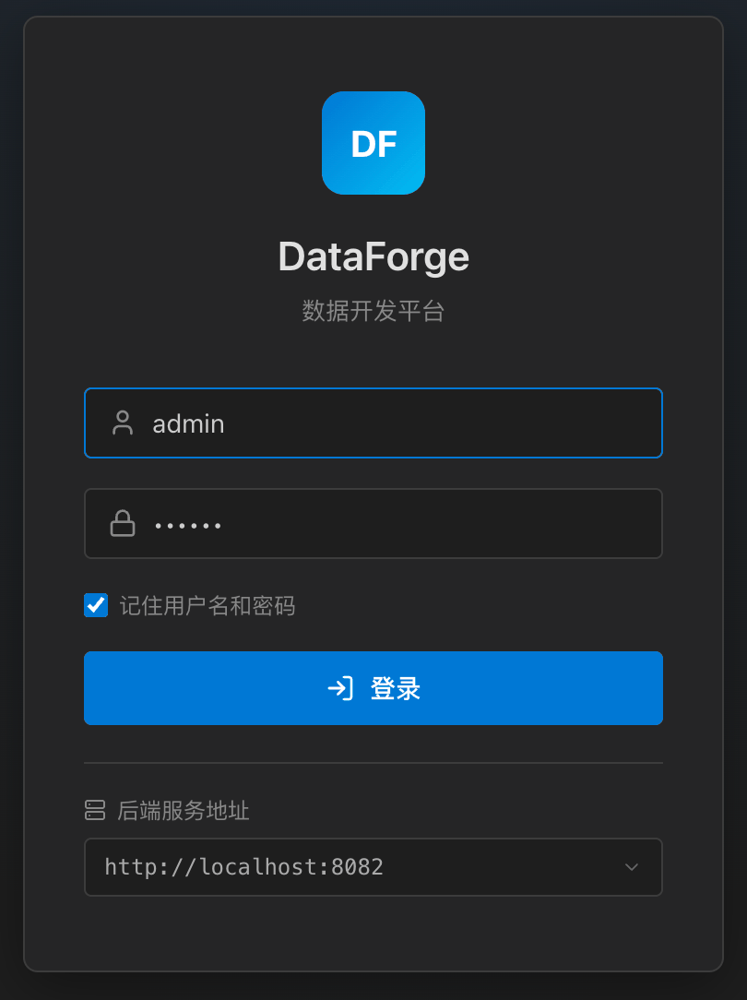
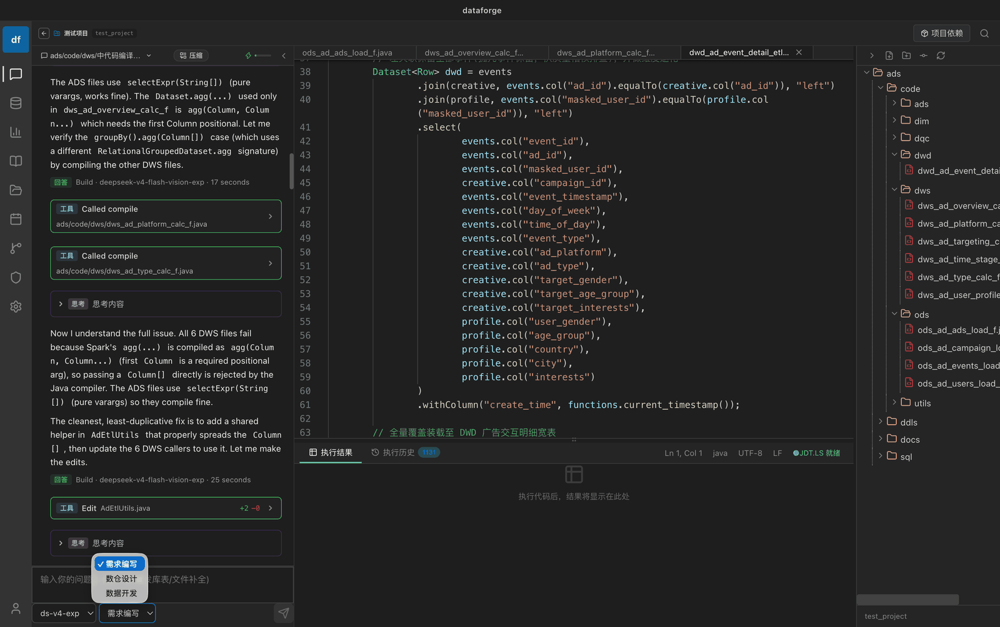
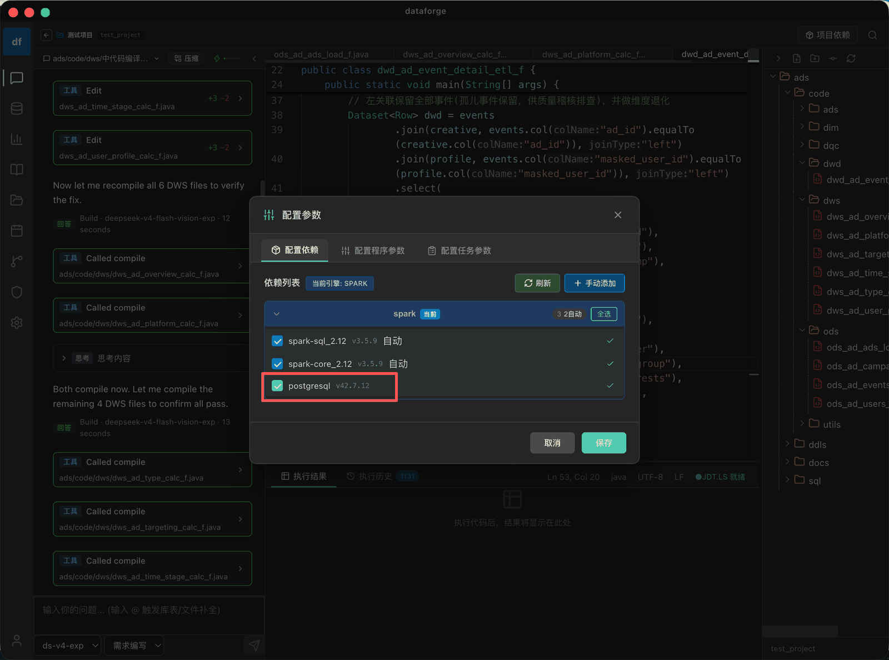
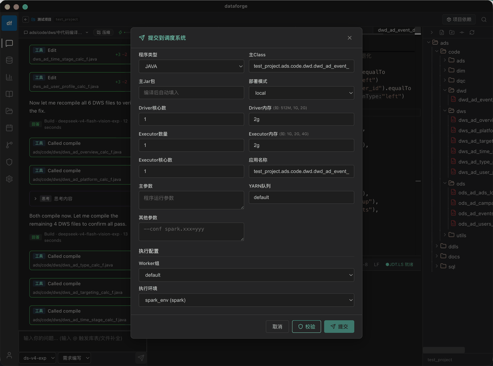
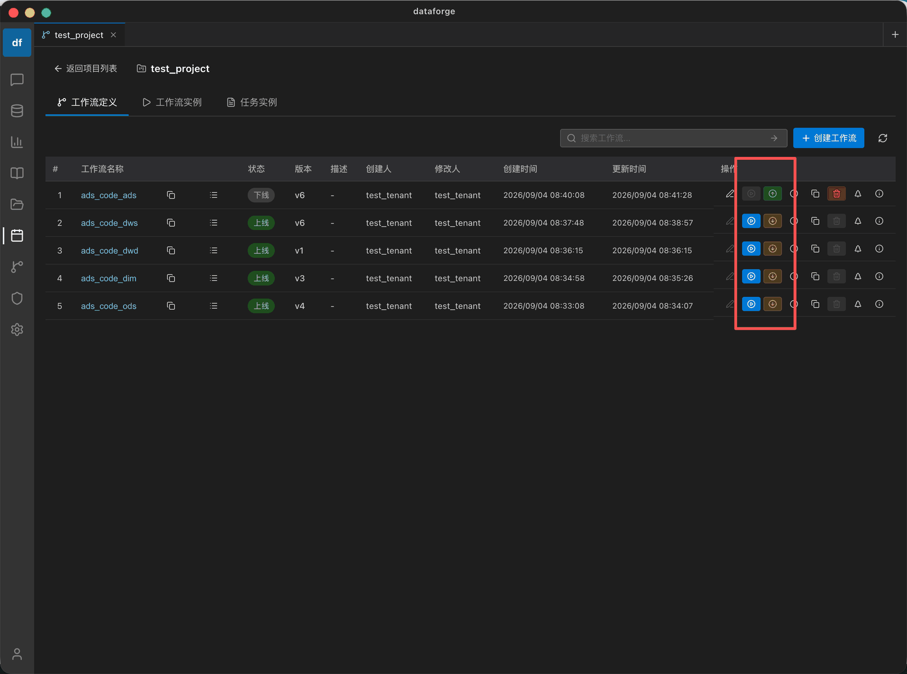
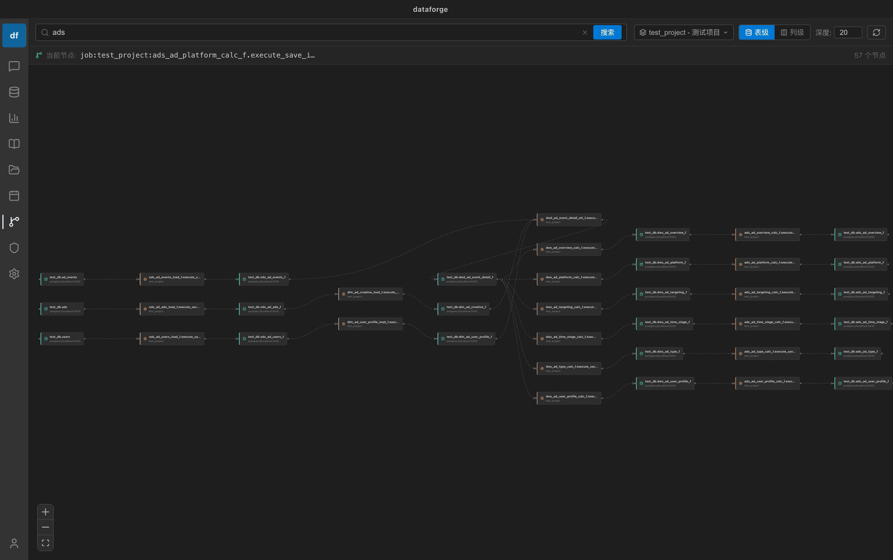
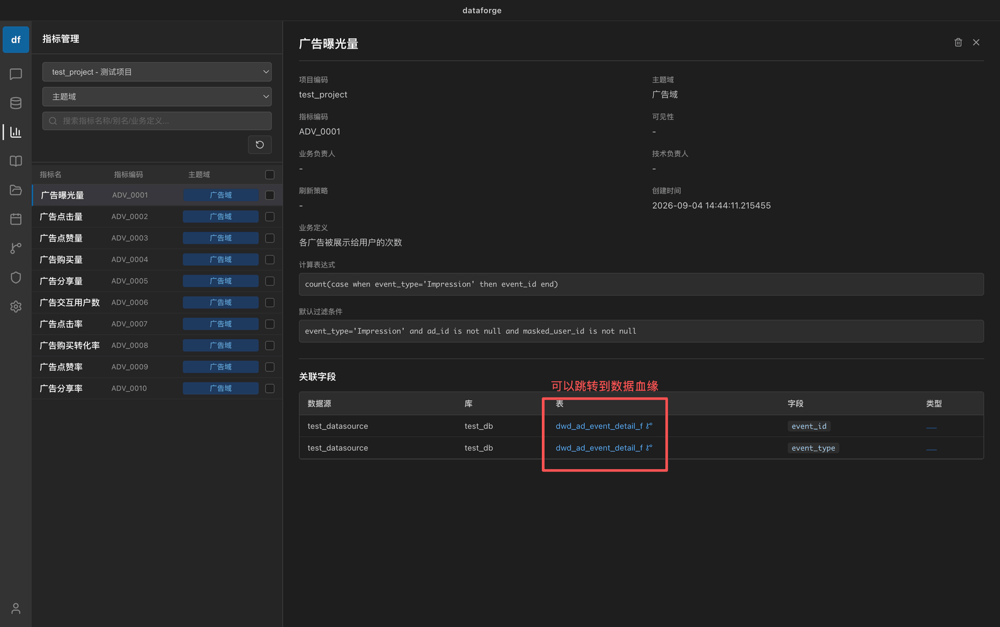
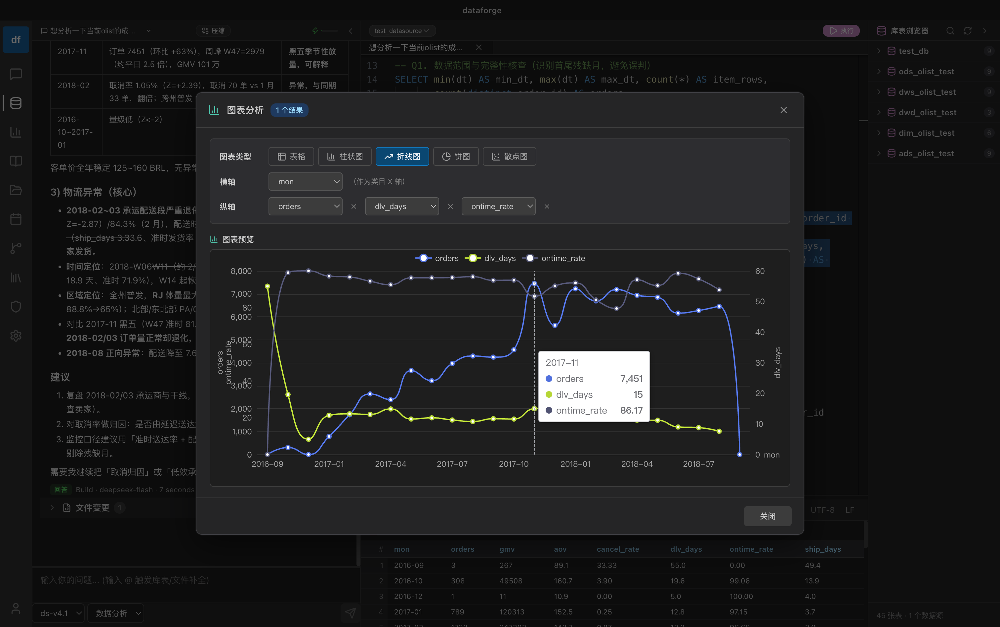

# 开始开发

> [文档首页](../README.md) › 快速开始

完成部署与开发配置后，即可基于初始化预置的资源开始首个数据开发任务。核心链路为：登录 → 进入项目 → 与智能体对话生成代码 → 配置依赖 → 提交调度 → 运行调度 → 查看数据血缘 → 查看指标 → 分析数据。其中涉及的「项目、调度、血缘命名空间」之间的映射关系详见「项目管理」。

## 1. 登录系统

使用预置账号登录平台（初始密码均为 `123456`）：使用 `admin`（超级管理员）可操作全部功能；使用 `test`（数据开发工程师场景）体验授权内的开发能力。在登录页填入 DataForge Server 的 API 地址（Docker 部署默认为 `http://localhost:8082`）即可登录。

*图：登录 DataForge 客户端*

## 2. 进入或创建项目

在「开发助手」中维护开发项目，项目是组织需求、代码、指标、数据源等开发资源的**基本单元**。可直接进入初始化预置的「测试项目」（test_project），或新建项目：填写项目名称、项目编码（英文唯一标识）、负责人与默认数据源后保存。

## 3. 与智能体对话生成代码

进入项目后，可在「开发助手」中借助 AI **智能体**按"需求编写 → 数仓设计 → 数据开发"的链路完成开发，由智能体理解需求并自动产出可运行的脚本 / 任务，全程在项目内闭环管理：

- **需求编写** — 通过自然语言描述业务诉求，智能体辅助梳理并产出需求文档与开发计划；
- **数仓设计** — 基于需求自动完成数仓分层（ODS / DWD / DWS / ADS）与维度建模，生成建表结构及建模 SQL；
- **数据开发** — 智能体生成 SQL / Java / Scala 脚本并自动挂载预置依赖，选择运行环境（引擎 / 数据源）后即可编译执行。

智能体由配置的 LLM 模型提供商驱动（见「配置 LLM 提供商」），AI 生成的脚本与任务同样遵循项目、角色的权限管控。

*图：与智能体对话，自动生成开发脚本 / 任务*

## 4. 配置依赖

智能体产出脚本后，需确认并配置脚本运行所依赖的环境与参数：数据源可直接选用预置的 `test_datasource`（指向 PG 演示库 `test_db`，含 `ad_events` 表）；Java / Scala 编译依赖使用预置的 `spark-core` / `spark-sql` / `postgresql-jdbc`；同时可配置运行参数（如执行引擎、并行度、内存等），编译打包时自动挂载。

*图：配置依赖与运行参数*

## 5. 提交调度

配置完成后，将脚本 / 任务一键发布为工作流（DolphinScheduler），选择调度规则（如运行周期、执行时间、依赖项目等）后提交，无需手工编排。

*图：配置并提交调度*

## 6. 运行调度

调度提交后即可上线运行。可通过调度列表实时查看任务实例的运行状态、日志与执行结果，支持手动触发、暂停 / 恢复与失败重跑。

*图：上线并运行调度任务*

## 7. 查看数据血缘

任务运行后，平台通过 Marquez 自动采集数据血缘与元数据入库，可在「血缘管理」中查看表级 / 字段级的来源与去向追溯，随时掌握数据的上下游依赖关系。

*图：查看数据血缘关系*

## 8. 查看指标

在「指标管理」中从开发结果沉淀指标口径，统一管理指标定义、字段与依赖关系。数仓设计文档中的「数据指标」章节会在此集中管理与维护。

*图：查看与管理指标*

## 9. 分析数据

指标定义完成后，可结合指标与调度结果查看对应的统计数据，并让智能体协助分析数据支持业务决策，形成"开发 → 调度 → 血缘 → 指标 → 分析"的完整闭环。

*图：分析数据*

---

| ← 上一篇 | 下一篇 → |
| --- | --- |
| [开发配置](configuration.md) | [项目管理](../guide/project-management.md) |

[返回文档首页](../README.md)
