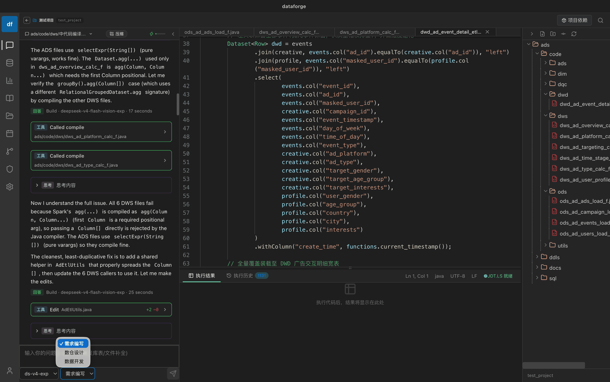
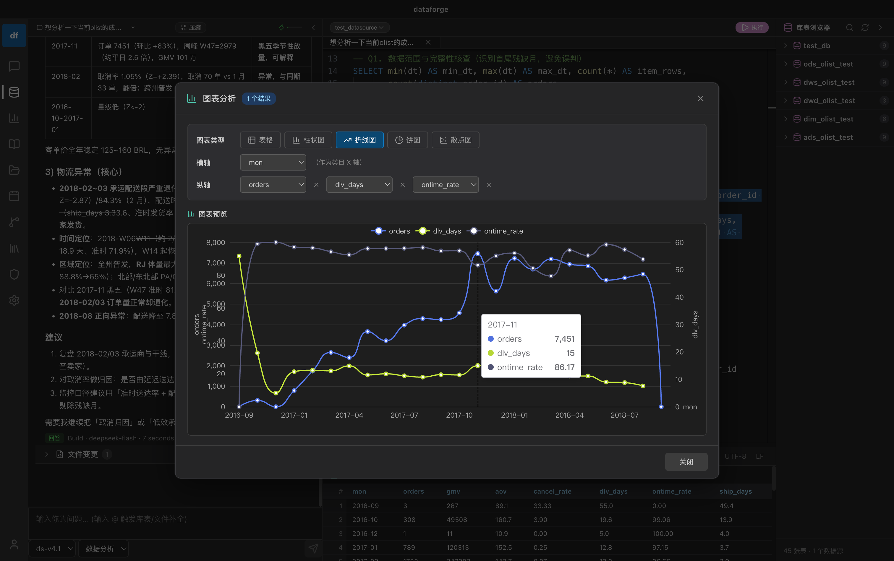
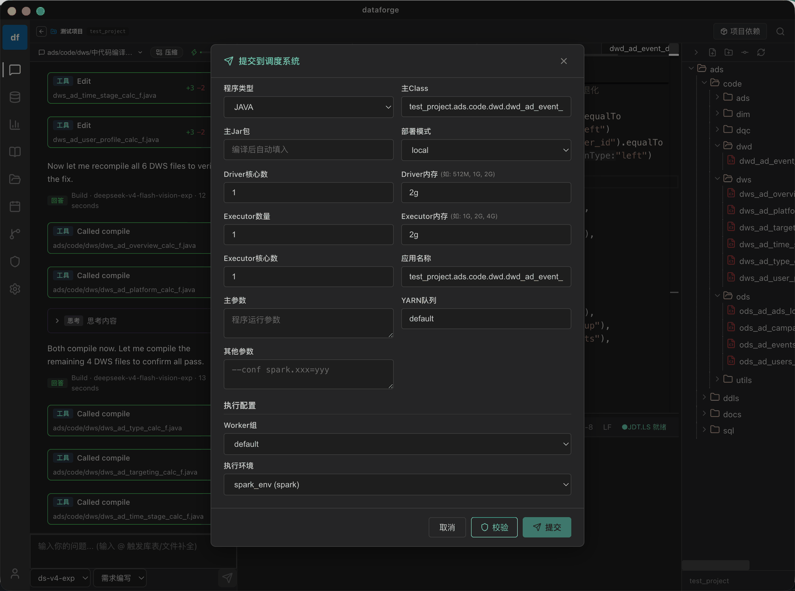
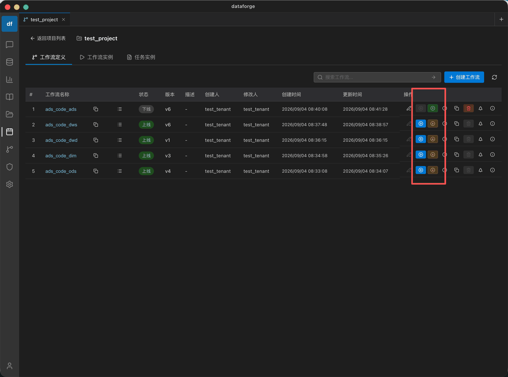
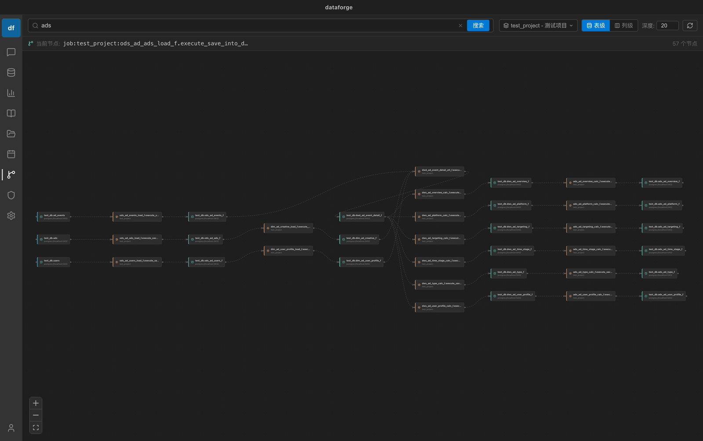

# 开发即治理

> [文档首页](README.md) › 产品与理念

## 让数据开发，天生具备治理能力

**需求文档进，治理合格的调度任务出。** DataForge 把指标口径、开发规范与血缘追踪直接内置进 AI 开发链路，让治理从「事后补救」变成开发的内生能力。

## 为什么需要治理

无治理的数据开发，是在给半年后的自己埋雷。治理缺失不会在提交那一刻报错，它只是在需求变更、人员流动、报表对不上时集中爆发——而那时修复成本已经翻了几倍。规范正确的数据，是 AGENT 智能分析数据的基础。

| 无治理的开发 | 开发即治理 |
| --- | --- |
| 指标口径各自定义，同名异义 —— 报表频繁对不上 | 指标口径统一注册 —— 业务语义全局一致 |
| 开发规范靠口口相传 —— 需求返工率高 | 规范内置知识库 —— AI 生成即合规，降低返工率 |
| 血缘关系不明 —— 问题平均定位困难 | 全链路血缘可视 —— 问题定位缩短至 10 分钟 |
| 经验随人走 —— 新人独立上手要 2 周以上 | 知识沉淀到平台 —— 新人 1 天即可独立开发 |

## 治理贯穿的四个环节

从需求到上线，治理能力贯穿这四个环节：

| 步骤 | 环节 | 说明 |
| --- | --- | --- |
| STEP 01 | **需求文档** | 用业务语言描述口径与预期产出，AI 解析成可执行的需求结构 |
| STEP 02 | **AI 生成代码** | 生成前自动检索知识库，遵守团队开发规范与技术框架 |
| STEP 03 | **规范校验** | 代码风格、血缘完整性、资源消耗在提交前一次性拦截 |
| STEP 04 | **提交调度** | 任务上线即纳管，自动注册指标、接入血缘与运行监控 |

## 产品速览：一句话需求，到一条带血缘的调度任务

不是概念动画，是产品里真实跑完的一条链路。下面每一步都对应产品中的实际界面（截取自真实运行环境，未使用示意图）。

### 01 说清需求

业务语言描述口径，不用先写 SQL。

**需求进来，先被拆成可执行的步骤。** 口径、维度、粒度、产出表写成一段业务语言，AI 复述理解后再动手；生成之前检索的是你团队的知识库、指标定义和代码框架。

### 02 探索验证

结果集直接出图，先看数对不对。

**先在数据探索里验证一遍。** 口径对不对、数据量是否合理、趋势能不能解释，图表直接开在结果集上，不用导出到 Excel 再画。

### 03 提交前校验

规范、参数、资源一次过。

**提交前先过校验，而不是上线后救火。** 代码规范、参数完整性、资源占用一次性检查；校验不过就改，问题不留给生产。

### 04 上线调度

直接提交 DolphinScheduler。

**校验通过，直接提交到 DolphinScheduler。** 工作流版本、上线状态、运行实例都在同一个界面里，不用再开一个调度系统对照着看。

### 05 血缘可查

表级、字段级自动落 Marquez。

**上线即纳管。** 表级、字段级血缘自动落到 Marquez，出问题从指标反查到源表，不用再问「这张表是谁写的」。

---

| ← 上一篇 | 下一篇 → |
| --- | --- |
| [产品能力总览](capabilities.md) | [环境准备](getting-started/environment.md) |

[返回文档首页](README.md)
